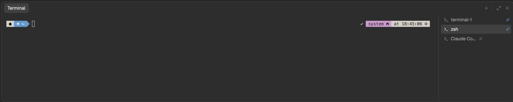

# Terminal Panel for Herdr

A VS Code-style terminal panel under Herdr's tab area, toggled with ⌃\`. One list of shells
is shared by every space; you can split, rename, color and re-icon them, link one to a
space so switching there selects it, pop one into its own window or turn it into a tab.
Agents running in the panel get status badges and alerts.

## Install

Ask your coding agent to add `herdr.dev/layouts/pastaghost/herdr-terminal-panel`, or by
hand:

1. Copy `layouts/main-drawer.json` to `~/.config/herdr-app/layouts/` and `mods/drawer/`
   to `~/.config/herdr-app/mods/`.
2. Merge `keys.json` into `~/.config/herdr-app/keys.json` (it adds global keys; ⌃\`, ⌘J,
   ⌃⇧\`, ⌘\\, ⌘⌥PageUp and ⌘⌥PageDown).
3. Run `herdr-app check ~/.config/herdr-app/mods/drawer`, then
   `herdr-app do layout.switch --name main-drawer`.

⌘⇧L switches back to your own layout. Deleting the two copied items removes it.

The mod runs `hc` to start and label the panel's shells, and edits its own layout file
(`layouts/main-drawer.json`) to show the selected shell. It fetches nothing from the
internet; for a space on another machine, it starts that space's shells there through
`hc --on`.

`RECIPE.md` describes the whole thing in enough detail to rebuild it from scratch.
