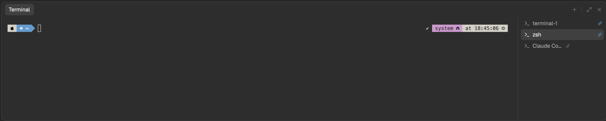

# Terminal Panel

A VS Code-style terminal panel under Herdr's tab area. ⌃\` shows and hides it. It holds a
list of shells shared by every space, docked on its right. You can split a shell, rename
it, color it, give it an icon, link it to a space, pop it into its own window or turn it
into a regular tab. Agents running in the panel get status badges and alerts, like Herdr's
own panes do.



## What you see

The layout is Herdr's `main` layout (sidebar, tab bar, status bar, Files and Changes
panels) with one addition. The tab area and the panel sit in one column with an 8px gap.
The panel is a card 260px tall (100px minimum) with a 10px radius, the theme's `background`
fill and a 1px `border`. Its border turns `accent` while one of its terminals has the
keyboard.

- **Header bar** (36px, across the whole panel): on the left, "Terminal" in a pill (13px,
  `selected` fill, 5px radius), like VS Code's active panel tab. On the right, 14px icon
  buttons in `dim` that turn `foreground` on hover: **+** (new terminal), a 1px divider,
  maximize/restore, and **×** (hide panel).
- **Terminal area** (left): the selected shell. A shell that's split shows its whole split
  group side by side, with 1px dividers between them. With no shells, it shows "No
  terminals" and a **New terminal** button.
- **Terminal list** (right, 210px; drag the 1px divider to resize it from 140 to 420px):
  one 26px row per shell, 13px text. Each row has a 14px icon (tinted with the shell's
  color, if it has one) and the shell's name: the name you gave it, else the program's
  ("zsh", "Claude Code"). The selected row has a `selected` fill; the other shells in the
  shown split group are `foreground`, the rest `muted`. Split groups are drawn as a tree
  with ┌ ├ └ in `dim` before the icon.
- **At the end of a row:** agent status (below), then a link marker. Shells linked to the
  shown space get an 11px link icon in `accent`. Shells linked to another space get the
  link icon and that space's name in `dim`, cut off at 96px. Hovering a row swaps the
  marker for split and trash buttons.

## How it behaves

**Showing it.** ⌃\` or ⌘J shows and hides the panel. **×** hides it; maximize grows it over
the tab area and restore puts back the height it had. Hiding a maximized panel gives the
whole column back to the tabs.

**Terminals.** **+** or ⌃⇧\` starts a shell in the folder the shown space is working in (its
focused pane's folder), on that space's machine. Clicking a row shows that shell and gives
it the keyboard. ⌘⌥PageDown and ⌘⌥PageUp go to the next and previous shell. Opening the
panel when there are no shells starts one, once; after that, only you start them. Killing
the last shell hides the panel.

**One list, optional links.** Every space shows the same list. Right-click a shell and
choose "Associate with ‘<space>’" to link it to the shown space. Switching to a space with
linked shells selects one: the one you used there last, else the first. Switching to a
space with none leaves the panel as it was. "Remove Association with ‘<space>’" unlinks
it. When a space closes, its shells are unlinked, not killed.

**Right-click menu** (300px popup; ↑/↓, Enter, Esc work):

| Item | What it does |
|---|---|
| Split Terminal ⌘\\ | A new shell beside this one, in its folder and its split group, linked to the same space. |
| Move Terminal into Editor Area | Turns the shell into a regular Herdr tab in its linked space (else the shown space) and selects it; a name it had becomes the tab's name. |
| Move Terminal into New Window | Opens the shell in a 760×460 window you drag by its title bar. The title bar shows its icon, name and status, a button to send it back to the panel, and a trash button. The window comes back after a restart. |
| Associate with ‘…’ / Remove Association with ‘…’ | Links or unlinks the shell and the shown space. |
| Change Color… | Default, Red, Green, Yellow, Blue, Magenta or Cyan, from the theme's ANSI colors; tints the shell's icon. |
| Change Icon… | A grid of 14 icons (4 per row, 40px cells). |
| Rename… | A dialog. Empty goes back to the program's name. |
| Kill Terminal | Ends the shell. |

Names, colors, icons, links and splits are stored on the shell itself, so they survive
restarts and every Herdr window shows the same.

**Agents in the panel.** Herdr's agents list and alerts only cover its own panes, so the
panel does its own for its shells:

- **working:** a 12px spinner in `working`, turning once every 900ms.
- **blocked:** a "Needs you" pill (10.5px, semibold, `blocked` text on 15% `blocked`).
  `error` shows "Error" in the same pill.
- **done:** finished while you weren't looking: a 7px dot in `done`. It clears once the
  shell is on screen in the open panel of a focused window.
- **Alerts:** when a shell becomes blocked or errors, or finishes while you aren't looking
  at it, you hear Herdr's `blocked` or `done` sound and get a notification ("<name> needs
  you", "<name> hit an error", "<name> finished"), with the linked space's name. Clicking
  it opens the panel. If the panel was hidden when the alert came, the panel opens on that
  shell, unless you're typing in another panel shell. An open panel never switches shells
  by itself.

## Built from

**Layout** (`layouts/main-drawer.json`): Herdr's `main` with its `work-body` row's first
child, the `main` tab block, wrapped as:

```
center (column, gap 8)
├─ main (Herdr's tab block, unchanged)
└─ drawer (column, 260px, min 100; background, radius 10, border, focus border accent)
   ├─ drawer-bar   block 36px   { mod: "drawer" }
   └─ drawer-body  row, 1px divider
      ├─ drawer-term  block       { mod: "drawer", props: { role: "empty" } }  ← the mod rewrites this
      └─ drawer-side  block 210px (140–420)  { mod: "drawer", props: { role: "list" } }
```

The layout sets no theme or fonts, so it follows each person's settings.

**Mod** (`mods/drawer/`): `main.js` draws; `sessions.js` holds the data and actions. Its
copies are told apart by `props().role`:

| Role | What it is |
|---|---|
| (none) | The header bar. It also runs everything: keeps `drawer-term` on the selection, links on space switch, status and alerts, key commands, requests from overlays, layout repair. |
| `list` | The terminal list. |
| `empty` | `drawer-term` with no shells. |
| `menu`, `color`, `icon` | Popups. |
| `rename` | A dialog. |
| `titlebar` | A windowed shell's title bar. |

- **The shells** are core terminals started with `hc run --json --keep --no-parent --bg
  --label herdr-drawer.panel=1 [--label herdr-drawer.space=<id>] [--label
  herdr-drawer.group=<address>] [--on <machine>] --cwd <folder>`. They carry no
  `herdr.space` / `herdr.tab` labels, so Herdr doesn't adopt them as tabs. Their state is
  labels set with `hc label`: `herdr-drawer.name`, `.color`, `.icon`, `.space` (the link),
  `.group` (the split group: its first member's address) and `.window` ("1" while in its
  own window).
- **What `drawer-term` shows** is changed by rewriting that one node in the layout file
  (`readTextFile`, then `writeTextFile` with the read text as `expected`). It becomes a
  `{ terminal }` block, a `row` of `drawer-term-<i>` terminal blocks for a split group, or
  the `empty` mod block.
- **Shared state:** `drawer.selected` (the selected address), `drawer.active` (space id →
  the linked shell used there last), `drawer.unseen` (finished, not yet seen),
  `drawer.attention` (the shell to show when the panel next opens), `drawer.restorePx`
  (the panel height to restore to), `drawer.req` (requests).
- **Commands it runs:** `layout.show`, `layout.hide`, `layout.resize` (maximize is
  `{ weight: 1000 }`), `pane.focus { terminal }`, `terminal.kill`, `tab.select`,
  `tab.rename`, `space.select`. It also uses `openOverlay`/`closeOverlay` (popups, a
  dialog, a `window` with `key` and `keep`), `notify`, `playSound`, `window().active`,
  `focused()`, `terminals()`, `spaces()`, `machines()` and `keys()` (menu hints).
- **Keys** (`keys.json`, global):

  | Key | Action |
  |---|---|
  | `ctrl-\`` | `layout.toggle:drawer` |
  | `cmd-j` | `layout.toggle:drawer` |
  | `ctrl-shift-\`` | `drawer.new` |
  | `cmd-\\` | `drawer.split` |
  | `cmd-alt-pagedown` | `drawer.next` |
  | `cmd-alt-pageup` | `drawer.prev` |

- **Art:** 14 icon-picker SVGs in `icons/` and the button icons (plus, x, chevron-down,
  maximize, restore, split, trash, link, panel, terminal, spinner). They are copies of
  Herdr's `workspace-chrome` and `pane` icons, plus trash, link and panel drawn for this
  mod: 16px viewBox, `currentColor` stroke.

## Watch out

- **Never `layout.set` with `layout()`.** `layout()` merges a column that has one child
  into that child, dropping the column's `size`, `hidden`, `min` and `max`. Setting it back
  destroys the panel's structure and the Files panel's wrapper (`panel`). Edit the layout
  file instead, one node at a time.
- **Herdr damages the layout when a shown terminal exits.** It removes the block and
  rewrites the file from that same simplified tree. So the panel's own kill first takes the
  shell out of the list, rewrites `drawer-term`, waits until it's off screen, and only then
  runs `terminal.kill`. `exit` typed in a shell can't be intercepted, so every 3 seconds the
  mod reads the file. While the panel's ids (`drawer`, `drawer-bar`, `drawer-body`,
  `drawer-term`, `drawer-side`) are all there, it saves the file's text in shared
  `drawer.layoutBackup` (per layout name). When one is missing, it writes that saved copy
  back with `drawer-term` set to the selection, so other edits to the layout survive.
  Only without a saved copy does it rebuild from the current `layouts/main.json` plus the
  panel, keeping the damaged file's theme, colors and fonts and the panel's size and hidden
  state. Only missing panel ids count as damage: a layout with other parts removed on
  purpose, or with no panel at all, is left alone.
- **`terminals()` lags behind `hc run`.** A loop like "no shells, so start one" starts
  dozens; an early build made about 30 a second. The panel starts one by itself at most
  once per load, and never more than one start per 500ms.
- **A hidden copy doesn't render, and nothing renders while the window is in the
  background, but timers run.** Everything the bar copy does (requests, status, alerts,
  sync) runs on a 500ms timer as well as in `render`. Status checks read only live data,
  so the timer is cheap.
- **Popups and dialogs can't await.** Their tasks are cancelled when they close. They post
  `{ seq, op, terminal, value }` to shared `drawer.req`, and the bar copy carries it out.
- **`terminal(address)` returns a different object than the list's.** Compare addresses,
  never objects (`indexOf` on the list returns -1).
- **Repair builds from `main`.** If a future Herdr release reshapes `main` so it no longer
  has a `work-body` row with a `main` child, repair posts a warning and stops. Move the
  panel into a fresh clone of `main` by hand.
- **"Toggle Size to Content Width"** from VS Code's menu isn't here, because Herdr can't
  change how a terminal lays out its text.
- **Agents in the panel don't appear in Herdr's sidebar agents list** and don't count
  toward a space's status. "Move Terminal into Editor Area" makes one a normal tab.
- **Status test without an agent:** a program that prints `ESC ] 7501 ; state=<idle |
  working | done | blocked | error> BEL` sets its terminal's status, e.g.
  `printf '\033]7501;state=blocked\007'`.
- **Remote spaces:** shells start with `--on <machine>`, and links compare the address
  prefix with the space's machine. Only tested on this computer.

## Done when

- `herdr-app check ~/.config/herdr-app/mods/drawer` passes and `herdr-app status` shows no
  errors.
- ⌃\` shows and hides the panel. With no shells, opening it starts exactly one, and
  `hc ls` stays at one a few seconds later.
- **+** adds a row and focuses the new shell. Clicking rows switches the terminal area.
- Split shows two shells side by side and ┌ └ in the list. Killing one leaves the other.
- Killing the shown shell from the menu leaves `layouts/main-drawer.json` with `drawer`,
  `drawer-body`, `drawer-term`, `drawer-side` and `panel` all present.
- Change the `status` block to 30px in the layout file and wait 4 seconds. Then damage the
  file the way Herdr does: remove `drawer-term`, and merge each one-child row or column into
  its child. Within about 3 seconds the file has all those ids again, and `status` is
  still 30px.
- Rename, Change Color and Change Icon show in the list, and `hc label <t> x=` prints the
  matching `herdr-drawer.*` labels.
- Associate a shell with space A, switch to space B (nothing linked), then back to A: the
  panel shows that shell again.
- "Move Terminal into New Window" opens a window, and its panel button brings the shell
  back. "Move into Editor Area" makes a tab in the space.
- Hide the panel and run `printf '\033]7501;state=working\007'; sleep 3; printf
  '\033]7501;state=blocked\007'; sleep 60` in a panel shell: a sound and a "needs you"
  notification arrive, and opening the panel shows that shell with "Needs you".
